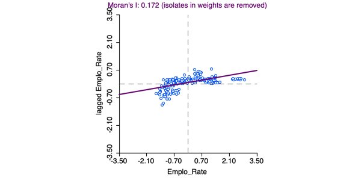
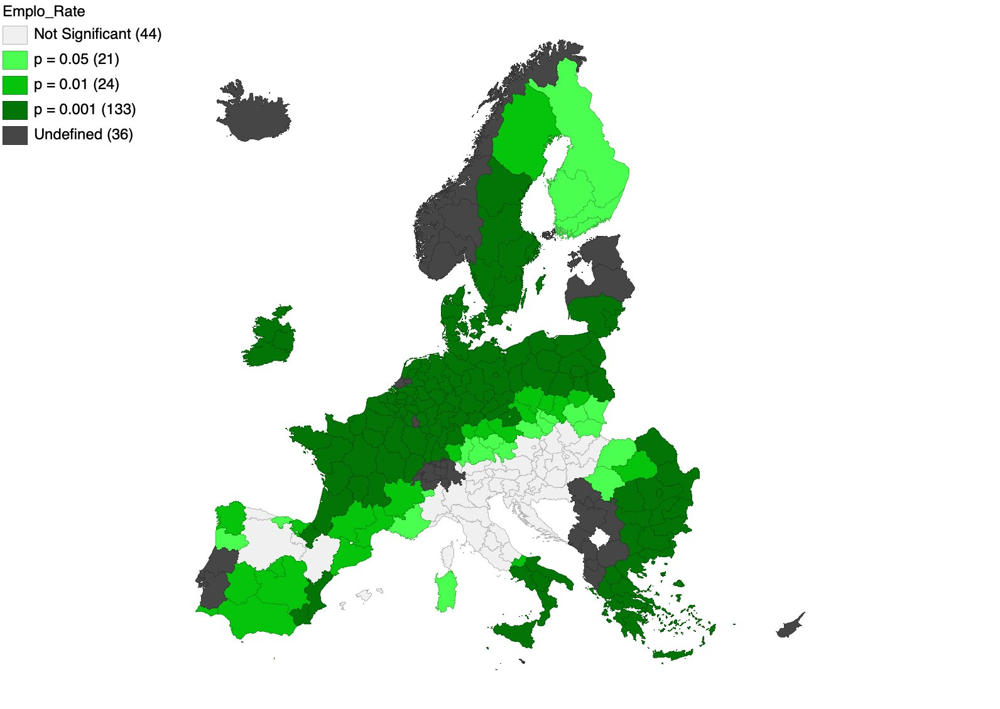
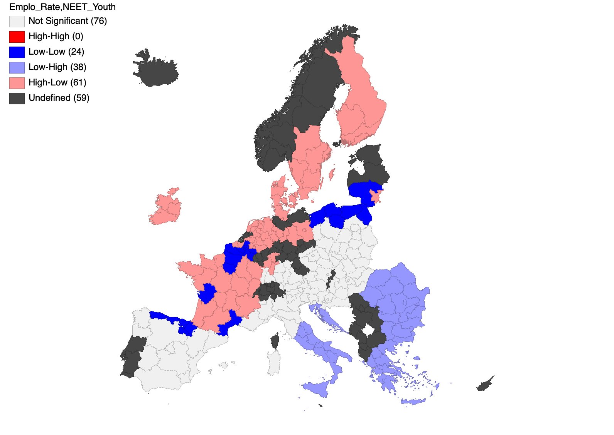

# What drives regional employment in the EU? A spatial analysis of NUTS 2 regions (GeoDa)

This project analyses how the employment rate in EU NUTS 2 regions relates to **unemployment by educational attainment** and the share of young people **not in employment, education or training (NEET)**, and whether these patterns spread across neighbouring regions. All analysis was carried out in **GeoDa**.

📄 **Full report (Romanian):** [report/report_ro.pdf](report/report_ro.pdf)

## Key results

- **Spatial clustering:** the employment rate is positively autocorrelated (global Moran's I = 0.172, p < 0.05, 999 permutations).
- **Clusters:** High-High in north-western Europe (Netherlands, Germany, Austria, Scandinavia), Low-Low in the south and south-east (Greece, Bulgaria, southern Italy, Spain).
- **Model choice:** OLS residuals are spatially autocorrelated, so a spatial model is required. The **Spatial Lag Model** has the lowest AIC and the highest log-likelihood.
- **Drivers:** unemployment by education (β = −0.795) and NEET youth (β = −1.088) both significantly reduce regional employment, with strong spatial spillovers (ρ = 0.821).

| | OLS | **Spatial Lag (chosen)** | Spatial Error |
|---|---:|---:|---:|
| R² | 0.433 | **0.490** | 0.460 |
| Log-likelihood | −767.14 | **−757.75** | −763.49 |
| AIC | 1540.28 | **1523.51** | 1532.98 |
| Schwarz (BIC) | 1550.14 | **1536.66** | 1542.84 |
| Unemployment by education | −1.125*** | **−0.795\*\*\*** | −0.917*** |
| NEET youth | −1.331*** | **−1.088\*\*\*** | −1.113*** |
| Spatial coefficient | — | **ρ = 0.821\*\*\*** | λ = 0.832*** |

*n = 198 regions, \*\*\* p < 0.001*

## Maps

### LISA cluster map: employment rate


### Exploratory maps
| Employment rate (quantiles) | Unemployment by education (natural breaks) | NEET youth (standard deviation) |
|---|---|---|
|  |  |  |

### Spatial autocorrelation
| Moran scatterplot | LISA significance | Bivariate LISA: employment × NEET |
|---|---|---|
|  |  |  |

More maps (bivariate LISA and significance maps) are in [`figures/`](figures/).

## Methods

| Step | Details |
|---|---|
| Data | Eurostat regional indicators: `lfst_r_lfe2emprt` (employment rate, Y), `edat_lfse_04` (unemployment by education, X1), `edat_lfse_20` (NEET, 15–29, X2), joined to NUTS 2 boundaries |
| ESDA | Quantile, natural breaks and standard deviation choropleth maps |
| Spatial weights | Distance band on centroids, threshold 1,335,937 m (every region has at least one neighbour) |
| Autocorrelation | Global Moran's I; univariate and bivariate LISA; 999 permutations |
| Regression | OLS with spatial diagnostics (Moran's I on residuals, robust LM tests), then ML Spatial Lag and Spatial Error models; selection following Anselin-Florax and information criteria |

## Repository contents

```
├── data/
│   ├── proiect_stat_spatiala.gda   # GeoDa project file
│   ├── nuts2_regions.shp/.dbf/.shx/.prj   # NUTS 2 boundaries
│   ├── matrice_W.gwt               # spatial weights matrix
│   ├── nuts2_indicators.csv        # Eurostat indicators used in the analysis
│   └── eurostat_raw_extract.xlsx   # raw Eurostat extract
├── figures/                        # maps and plots exported from GeoDa
└── report/report_ro.pdf            # full written report (Romanian)
```

To open the analysis, install [GeoDa](https://geodacenter.github.io/) and load `data/proiect_stat_spatiala.gda`.

## References

- Anselin, L. (1988). *Spatial Econometrics: Methods and Models*. Kluwer.
- Anselin, L. (1995). Local Indicators of Spatial Association: LISA. *Geographical Analysis*, 27(2), 93–115.
- Elhorst, J. P. (2014). *Spatial Econometrics: From Cross-Sectional Data to Spatial Panels*. Springer.
- LeSage, J., & Pace, R. K. (2009). *Introduction to Spatial Econometrics*. CRC Press.

---

**Ioana Galoș**, Faculty of Cybernetics, Statistics and Economic Informatics, Bucharest University of Economic Studies (ASE)
