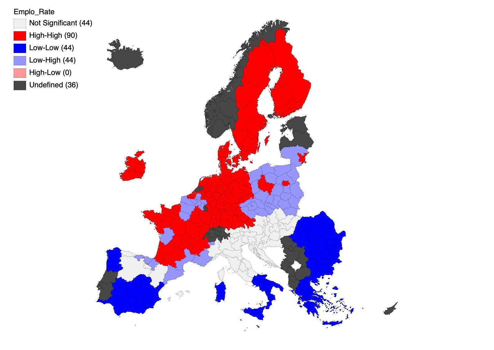
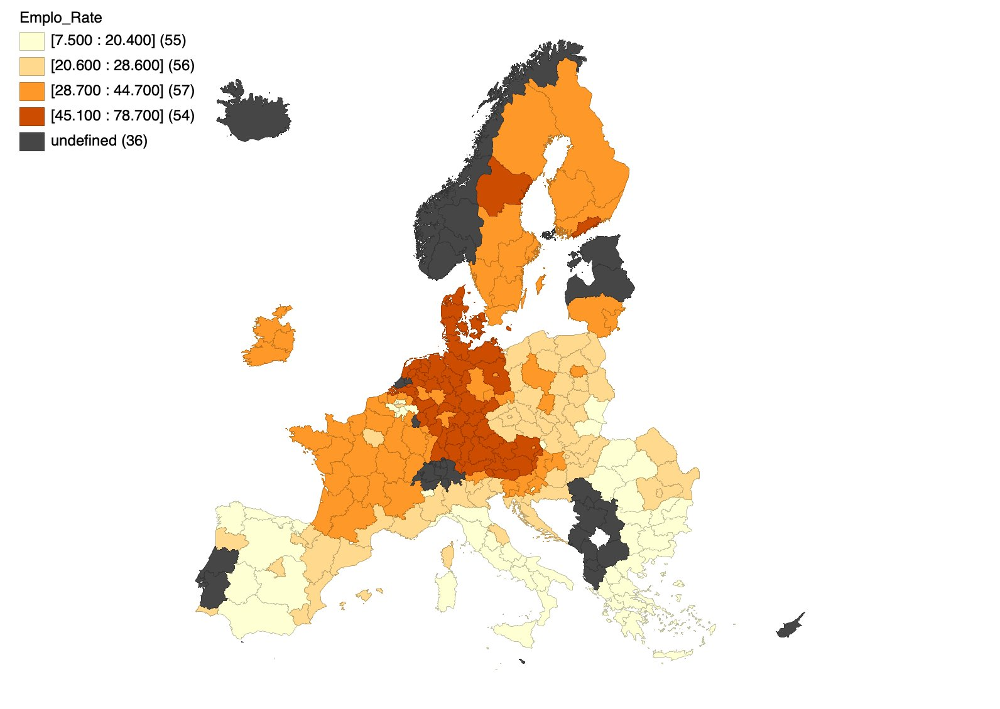
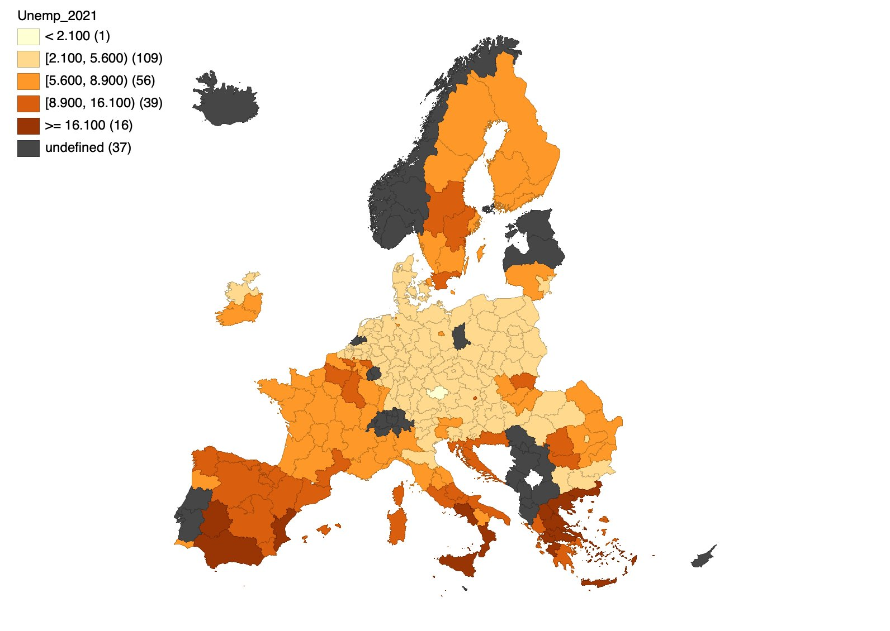
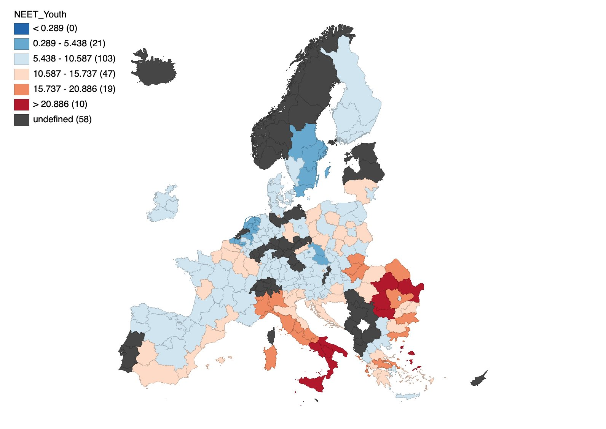

# Regional employment in the EU: a spatial analysis (GeoDa)

In this project I looked at what drives the employment rate across EU NUTS 2 regions, focusing on unemployment by level of education and on the share of young people who are not in employment, education or training (NEET). I also wanted to see whether a region's employment depends on what happens in the regions around it. The whole analysis was done in GeoDa, using Eurostat data.

The full report (in Romanian) is in [report/report_ro.pdf](report/report_ro.pdf).

## Results

Employment is not spread randomly across Europe. The global Moran's I is 0.172 (p < 0.05), so regions with high employment tend to sit next to other high-employment regions. The LISA map shows a High-High cluster in the north-west (Netherlands, Germany, Austria, Scandinavia) and a Low-Low cluster in the south and south-east (Greece, Bulgaria, southern Italy, Spain).

The OLS residuals were still spatially autocorrelated, so I compared two spatial models. The Spatial Lag Model fit best (lowest AIC, highest log-likelihood). In this model, both unemployment by education (β = −0.795) and NEET youth (β = −1.088) lower regional employment, and the spatial coefficient ρ = 0.821 shows a strong link between neighbouring regions.

| | OLS | Spatial Lag (chosen) | Spatial Error |
|---|---:|---:|---:|
| R² | 0.433 | 0.490 | 0.460 |
| Log-likelihood | −767.14 | −757.75 | −763.49 |
| AIC | 1540.28 | 1523.51 | 1532.98 |
| Unemployment by education | −1.125*** | −0.795*** | −0.917*** |
| NEET youth | −1.331*** | −1.088*** | −1.113*** |
| Spatial coefficient | – | ρ = 0.821*** | λ = 0.832*** |

n = 198 regions, *** p < 0.001

| Employment rate | Unemployment by education | NEET youth |
|---|---|---|
|  |  |  |

## Method

The variables come from Eurostat: employment rate (lfst_r_lfe2emprt), unemployment by educational attainment (edat_lfse_04) and NEET youth aged 15–29 (edat_lfse_20). I started with choropleth maps for each variable, then built a distance band weights matrix on region centroids (threshold 1,335,937 m, so every region has at least one neighbour). For spatial autocorrelation I used the global Moran's I and univariate and bivariate LISA, with 999 permutations. Finally, I estimated an OLS model and, based on its diagnostics, the Spatial Lag and Spatial Error models, choosing between them with the Anselin-Florax approach and the information criteria.

## Files

The data folder has the original GeoDa project (proiect_stat_spatiala.gda), the NUTS 2 shapefile, the weights matrix (matrice_W.gwt) and the Eurostat data. The figures folder has all the maps exported from GeoDa, and the report folder has the written report. To open the analysis, load the .gda file in [GeoDa](https://geodacenter.github.io/).

Ioana Galoș, Faculty of Cybernetics, Statistics and Economic Informatics, Bucharest University of Economic Studies (ASE)
